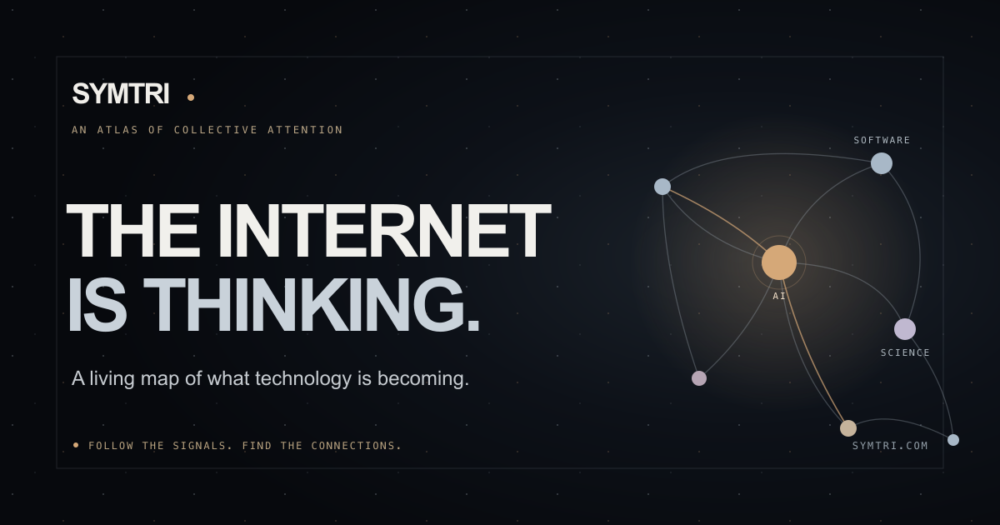
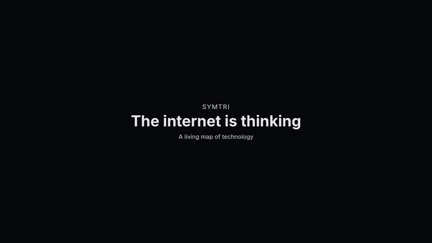

<div align="center">

<a href="https://symtri.com"></a>

# SYMTRI

**Follow the signals. Find the connections.**

An open-source atlas of technology research, projects, and discussion.
Explore a living knowledge map, ask questions with cited evidence, and follow ideas back to their original sources.

[**Explore the live map →**](https://symtri.com) · [Browse knowledge](https://symtri.com/#browse-knowledge) · [Weekly signal](https://symtri.com/signal) · [Contribute](CONTRIBUTING.md)

[](https://github.com/stanleycyang/symtri/actions/workflows/ci.yml)
[](LICENSE)
[](package.json)
[](package.json)
[](https://github.com/stanleycyang/symtri/stargazers)
[](#why-symtri)
[](CONTRIBUTING.md)

</div>

⭐ If you like where this is going, star the repo — it's the easiest way to help others find it.

<p align="center">
  
</p>

<div align="center">
</div>

## Why SYMTRI?

A paper, a repository, and a discussion can be parts of the same story. SYMTRI brings those observations into one explorable map, preserving the sources that let you judge the story yourself.

- **Explore connected ideas.** Move from regions to threads to individual sources in a 3D universe, or use the lightweight browsing experience without WebGL.
- **Ask with evidence.** Search the archive and get source-linked answers with supporting passages. When matching evidence is missing, Ask says so.
- **Follow more than one feed.** Discover research, code, advisories, and discussion from Hacker News, GitHub, arXiv, OpenAlex, NASA, CISA, Europe PMC, Hugging Face, and qualifying RSS feeds.
- **Watch the map evolve.** Hourly ingestion builds the archive; daily snapshots preserve earlier views. Recurring evidence can grow new map threads.
- **Read the weekly signal.** Saved briefings connect selected findings to practical questions, with citations and source limitations.

The map reflects connected sources and sampled observations. A connection means shared subject evidence, and AI summaries still need your judgment. Read [how the data works](docs/development.md#data-and-deployment).

## Try it in two minutes

Use **Node.js 24** and npm. No API keys or database are required for the local public-source preview.

```bash
git clone https://github.com/stanleycyang/symtri.git
cd symtri
npm ci
npm run dev
```

Open **http://127.0.0.1:3000**. Enter the universe, drag to orbit, scroll to zoom, and select a region to explore. Use Escape to return outward.

The preview depends on public source availability and rate limits. Persistent history, hourly workflows, and AI synthesis need server configuration; start with [.env.example](.env.example) and the [development guide](docs/development.md#data-and-deployment). Keep credentials out of Git.

## Under the hood

```text
Public sources → bounded ingestion → canonical archive + source evidence
                                            ↓
                               classification + knowledge graph
                                            ↓
                         live map · archive search · Ask · weekly signal
```

| Layer | Stack |
| --- | --- |
| Application | Next.js 16 App Router · React 19 · TypeScript |
| Universe | Three.js · React Three Fiber · Drei |
| Archive and retrieval | PostgreSQL · pgvector · indexed text search |
| Background processing | Vercel Workflow · scheduled ingestion |
| AI | Vercel AI Gateway · passage-backed generation and support checks |

The overview loads up to 300 signal details. Activity and recent relationship counts use the full 14-day archive; focused topics and Ask can retrieve beyond that overview cap. See the [application flow](docs/symtri-flow.svg) and [architecture guide](docs/architecture.md).

## Build with us

There is useful work here for more than code contributors. Help refine a classification, reproduce a navigation bug, improve a source adapter, or make the setup docs easier to follow.

| You want to… | Start here |
| --- | --- |
| Make your first contribution | [Contributor guide](CONTRIBUTING.md#your-first-contribution) |
| Fix a bug | [Report a reproducible issue](https://github.com/stanleycyang/symtri/issues/new?template=bug_report.yml) |
| Improve source coverage or classification | [Propose an evidence improvement](https://github.com/stanleycyang/symtri/issues/new?template=data_quality.yml) |
| Suggest a feature | [Explain the use case](https://github.com/stanleycyang/symtri/issues/new?template=feature_request.yml) |
| Understand priorities | [Public roadmap](ROADMAP.md) |

Read the [contribution guide](CONTRIBUTING.md), [community standards](CODE_OF_CONDUCT.md), and [security policy](SECURITY.md) before opening a pull request. Smaller, focused contributions are welcome.

If SYMTRI helps you discover something worth following, **star the repo** to help other builders find it. Share a source-linked map location with someone who works on that subject.

## Documentation

- [Development guide](docs/development.md) — configuration, checks, interaction QA, ingestion, and retrieval.
- [Architecture](docs/architecture.md) — code map and data flow.
- [Production operations](docs/production-operations.md) — releases, monitoring, and recovery.
- [Documentation index](docs/README.md) — deeper implementation and verification notes.

## License

SYMTRI code is released under the [MIT license](LICENSE). Retrieved articles, abstracts, advisories, and other source material retain their original ownership and applicable terms.
